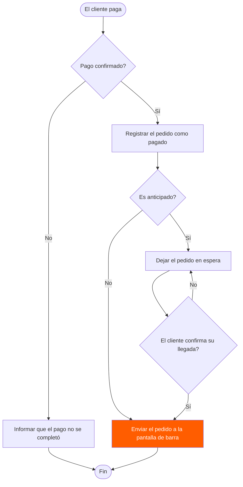
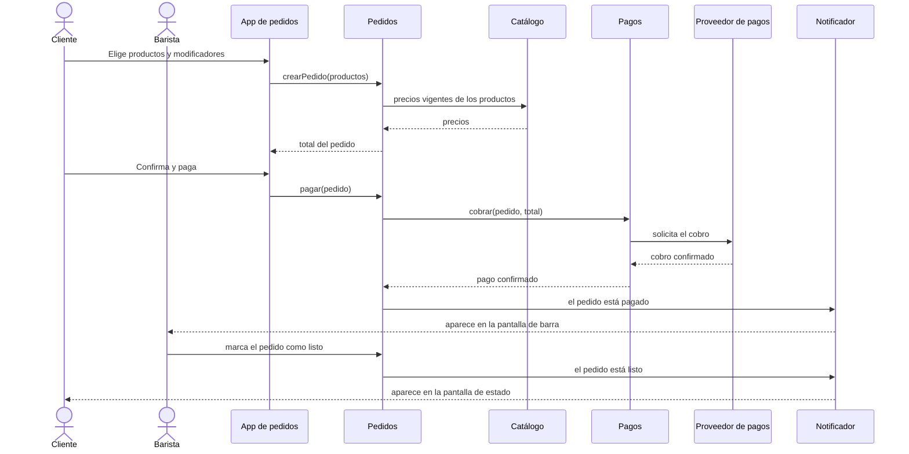
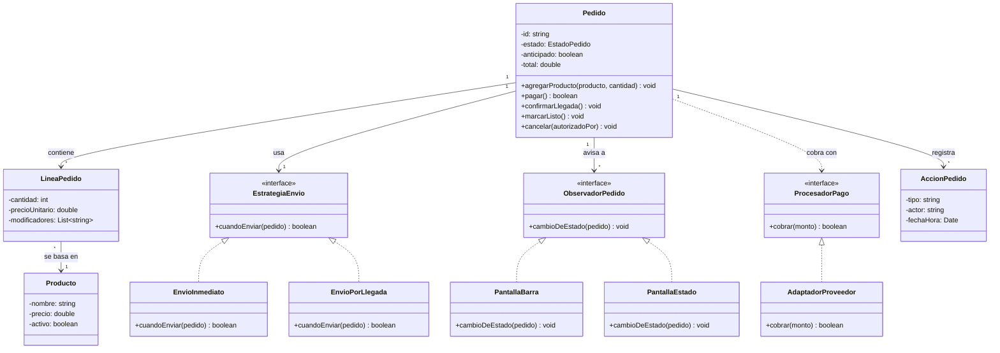
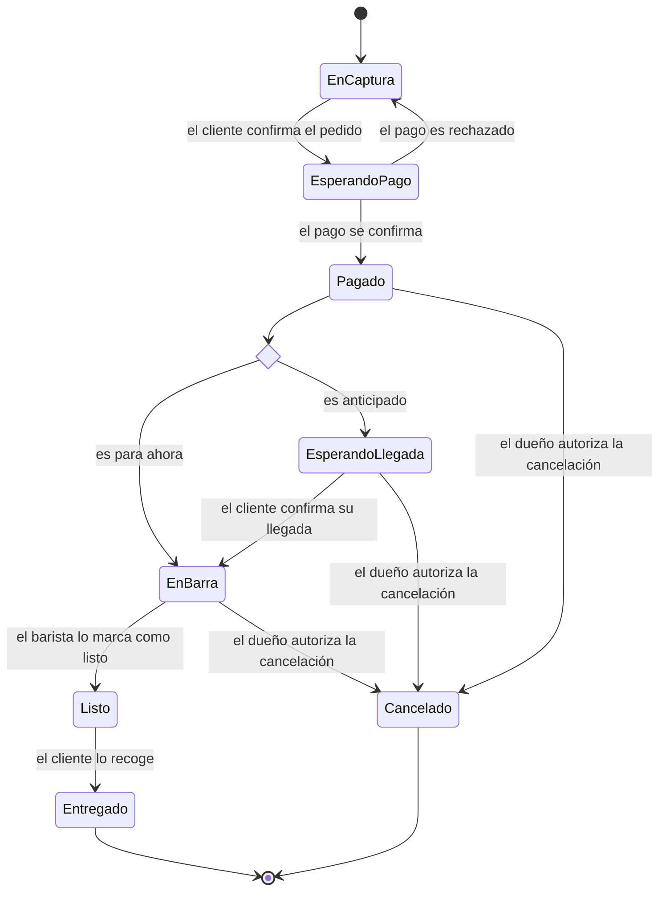
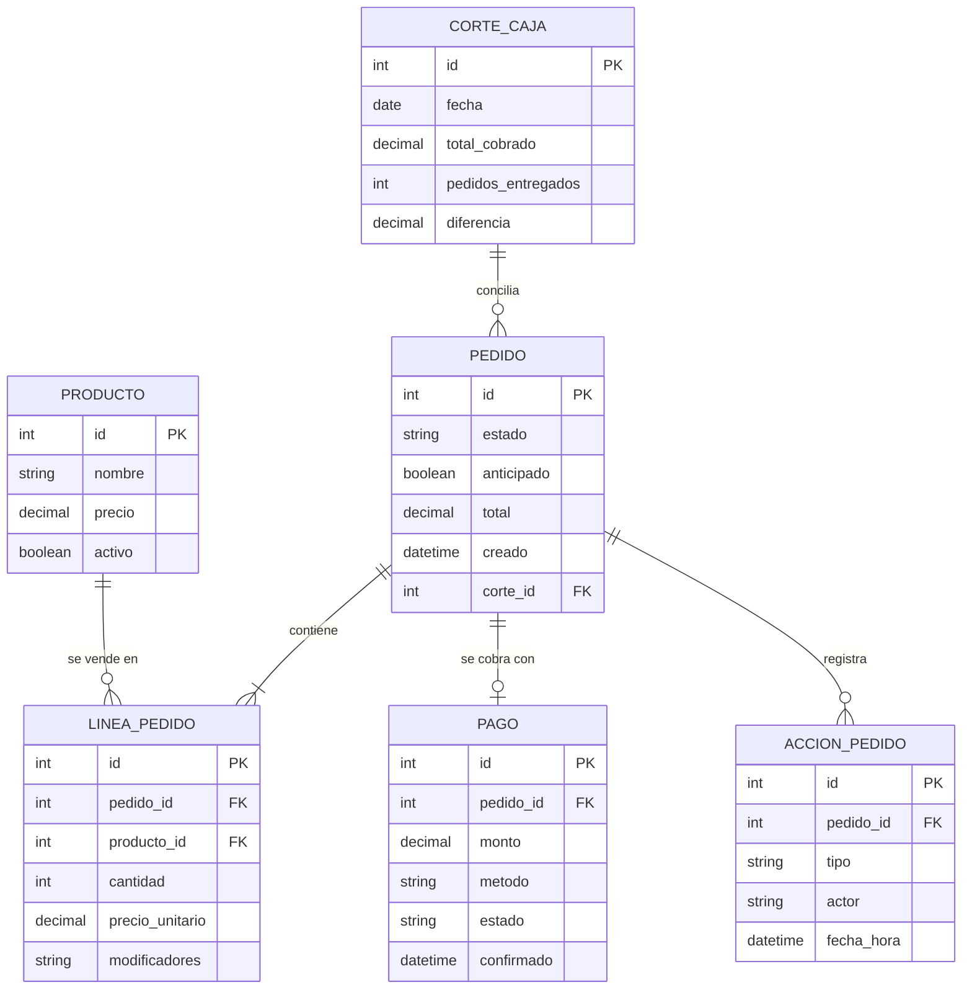

# Diagramas del proyecto — sin-cajero

Cinco diagramas de sin-cajero escritos como texto de Mermaid: flujo, secuencia, clases, estados y entidad-relación. Complementan los tres niveles C4 de `diagramas.md`: aquel dibuja las piezas del sistema y este dibuja cómo se comportan por dentro.

GitHub los dibuja directo en esta página y también se pueden pegar en [mermaid.live](https://mermaid.live). Los requisitos que se mencionan (RF, RNF) están en `docs/especificacion-requisitos.md`, y la decisión de fondo (monolito modular) en `adr-001-monolito-modular.md`.

---

## 1 · Diagrama de flujo: qué pasa cuando se confirma un pago

La regla central del negocio: un pedido solo llega a la barra si está pagado (RF-004), y uno anticipado espera a que el cliente avise que llegó (RF-005).

Si el pago se rechaza, el pedido no se registra y nunca aparece en la barra (flujo alterno FA-1 del caso de uso CU-02). Un pedido anticipado no sale a la barra por haber pasado su hora, solo por la confirmación de llegada.

---

## 2 · Diagrama de secuencia: un pedido desde el celular, de la orden al aviso de listo

Los mensajes entre las piezas del nivel 3 de los diagramas C4 cuando el cliente ordena desde el celular para ahora (CU-02 y CU-04).

Cada flecha entre módulos es una llamada a la interfaz del módulo dueño, no una lectura de sus tablas (regla del ADR-001). El tiempo entre "cobro confirmado" y "aparece en la pantalla de barra" es el que limita RNF-REN-001: menos de 8 segundos.

---

## 3 · Diagrama de clases: el pedido y sus reglas

Las clases del módulo Pedidos y lo que lo rodea. Se usan tres patrones: una estrategia para decidir cuándo sale el pedido a la barra, observadores para avisar los cambios de estado (RF-007) y una interfaz para el cobro, de modo que cambiar de proveedor de pagos solo cambie el adaptador.

`precioUnitario` en la línea guarda el precio del catálogo vigente al momento de la orden, así que un cambio posterior de precio no altera un pedido ya hecho (RF-003). `AccionPedido` es la bitácora que pide RNF-SEG-002 y de donde sale el corte de caja.

---

## 4 · Diagrama de estados: la vida de un pedido

Por qué estados pasa un pedido y qué evento lo mueve de uno a otro.

Un pedido solo llega a `EnBarra` desde `Pagado` o `EsperandoLlegada`, nunca desde `EnCaptura` ni `EsperandoPago` (RF-004, RNF-SEG-001). La única salida de un pedido ya pagado, además de entregarse, es `Cancelado`, y solo con autorización del dueño (RF-010). El barista no tiene ninguna transición que cambie el monto (RF-009).

---

## 5 · Diagrama entidad-relación: la base de datos

Las tablas de una cafetería y cómo se relacionan. No hay una tabla de cafeterías porque el nivel 2 define un esquema de base de datos por cafetería: lo que aísla a una de otra es el esquema, no una columna.

Cada tabla tiene un solo módulo dueño, y es el único que escribe en ella: Catálogo (`PRODUCTO`), Pedidos (`PEDIDO`, `LINEA_PEDIDO`), Pagos (`PAGO`) y Caja (`ACCION_PEDIDO`, `CORTE_CAJA`). Los demás módulos piden lo que necesitan por la interfaz del dueño, como dice el ADR-001. `PAGO` es opcional respecto de `PEDIDO` porque un pedido nace antes de cobrarse, y la auditoría de RNF-SEG-001 se hace cruzando `PEDIDO` con `PAGO`.
