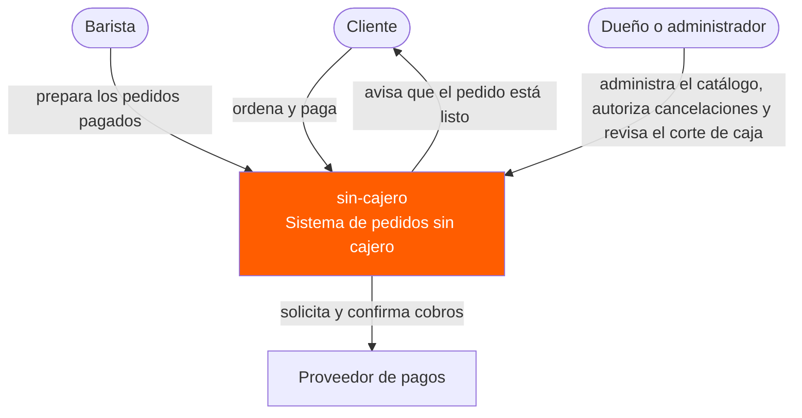
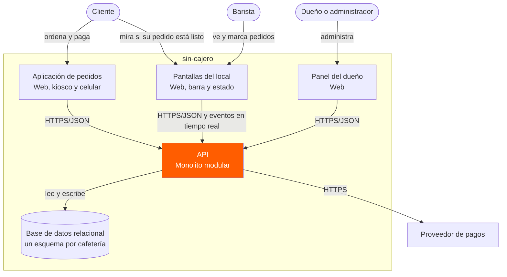
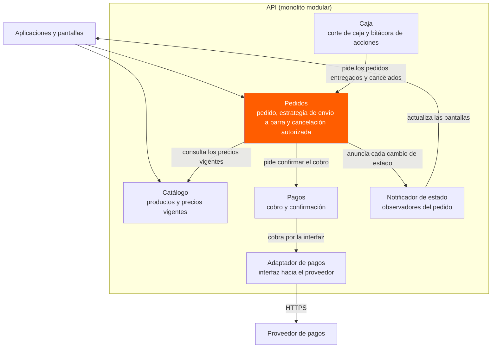

# Diagramas de arquitectura — sin-cajero

Tres niveles del modelo C4, escritos como texto de Mermaid (se versionan igual que el código). GitHub los dibuja directo en esta página; también se pueden pegar en [mermaid.live](https://mermaid.live).

Los módulos y las reglas salen de `docs/especificacion-requisitos.md`; la decisión de fondo (monolito modular) está en `adr-001-monolito-modular.md`.

---

## Nivel 1 · Diagrama de contexto

El sistema completo como una sola caja, quién lo usa y con qué sistema de fuera habla. Sin tecnología.

El cliente nunca pasa por un cajero: ordena y paga solo. El barista solo ve pedidos ya pagados (RF-004, RF-006) y el dueño es el único que cancela un pedido pagado (RF-010).

---

## Nivel 2 · Diagrama de contenedores

Las piezas que se despliegan por separado, con su tecnología. El `subgraph` es la frontera: lo de adentro es sin-cajero, lo de afuera no.

Hay un solo backend (la API) porque la arquitectura elegida es un monolito modular. Las dos pantallas del local reciben los cambios por eventos para cumplir RNF-REN-001 (menos de 8 segundos entre el pago y la barra). La base usa un esquema por cafetería para aislar el corte de caja de cada una (RNF-SEG-002).

---

## Nivel 3 · Diagrama de componentes

Lo que hay dentro de la API, que es el contenedor donde viven las reglas de negocio.

Cómo leerlo:

- **Pedidos** es el centro del sistema; Catálogo, Pagos y Caja solo hablan con Pedidos y no entre sí.
- Ningún módulo lee las tablas de otro: cada uno escribe solo en las suyas, dentro de la base de datos del nivel 2, y pide lo demás por la interfaz del módulo dueño (regla de ADR-001).
- El **Notificador** es el Observer de RF-007: Pedidos anuncia el cambio de estado y las pantallas reaccionan sin que Pedidos las conozca.
- El **Adaptador de pagos** está como interfaz, no con el nombre de un proveedor: si el proveedor cambia, solo cambia el adaptador.
