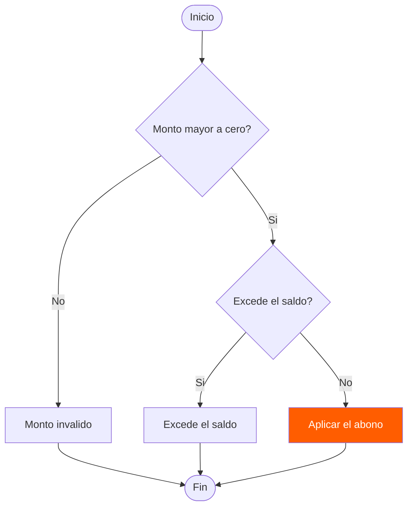
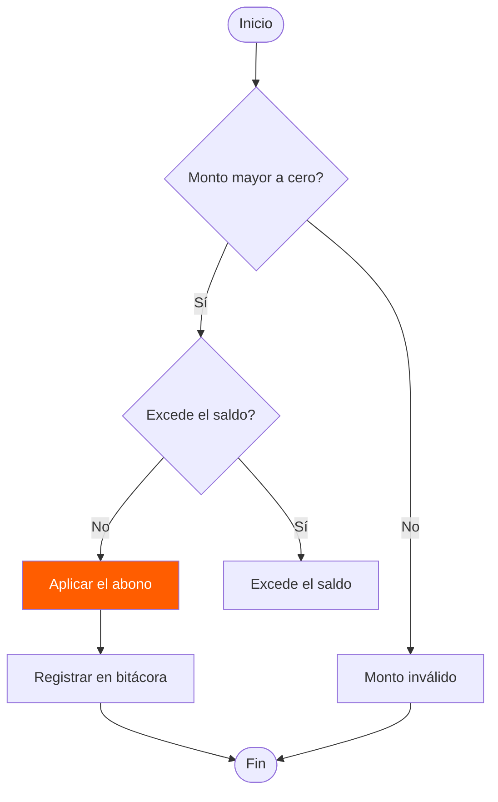
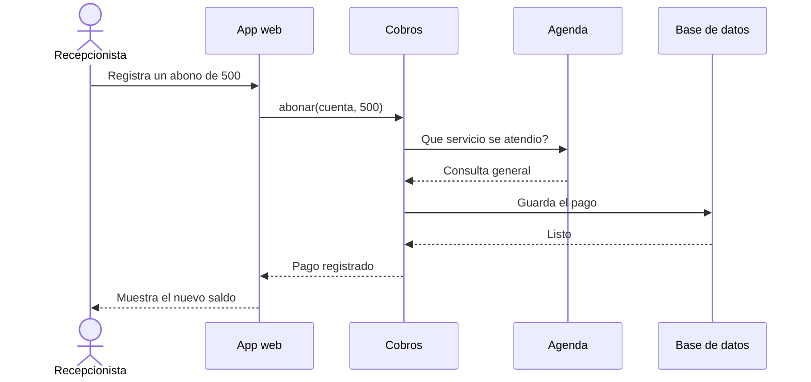
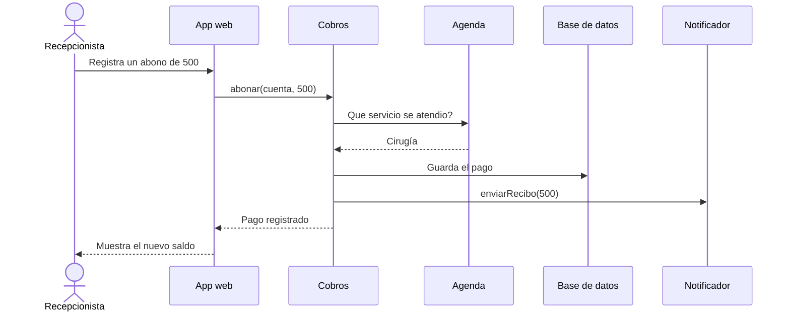
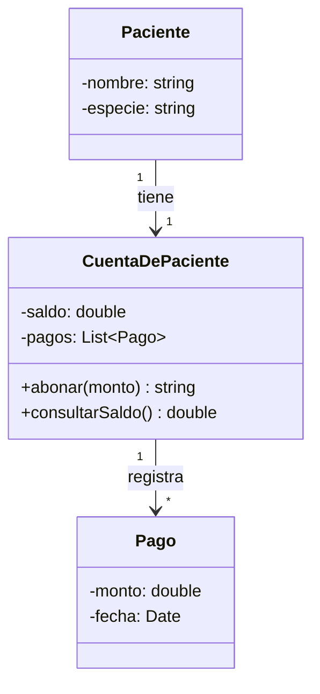
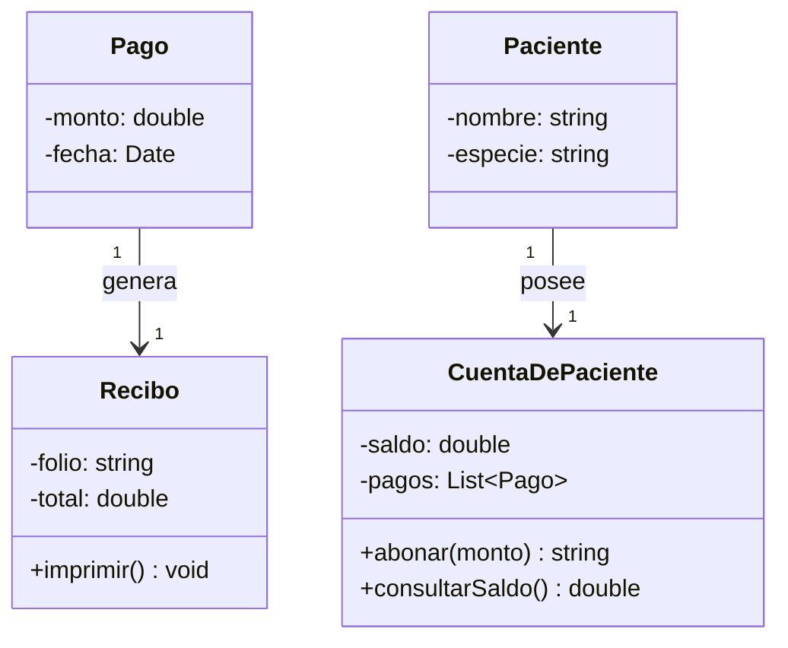
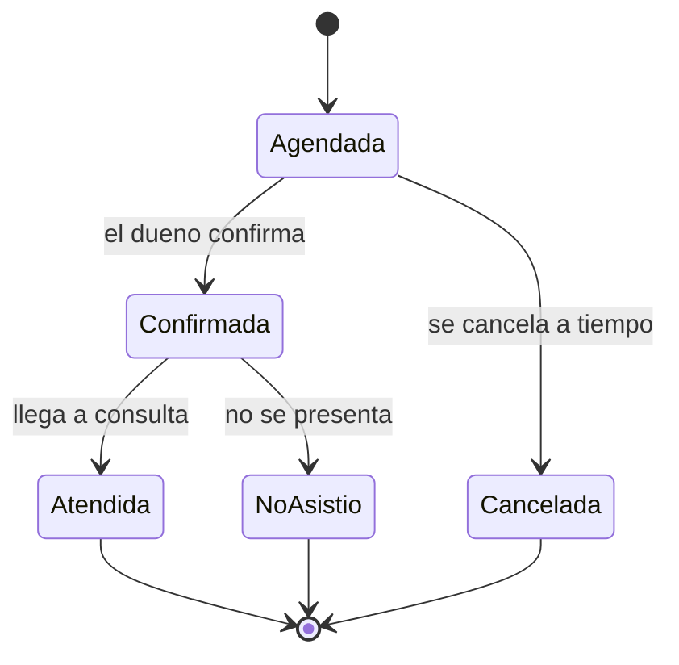
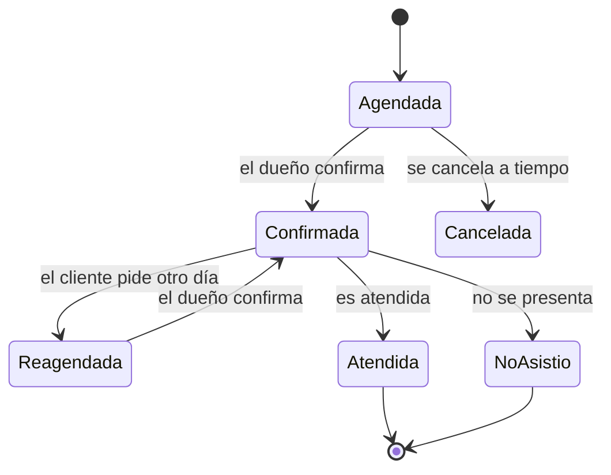
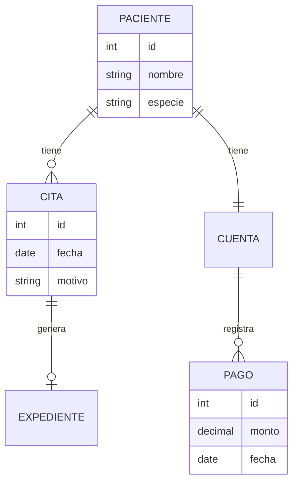
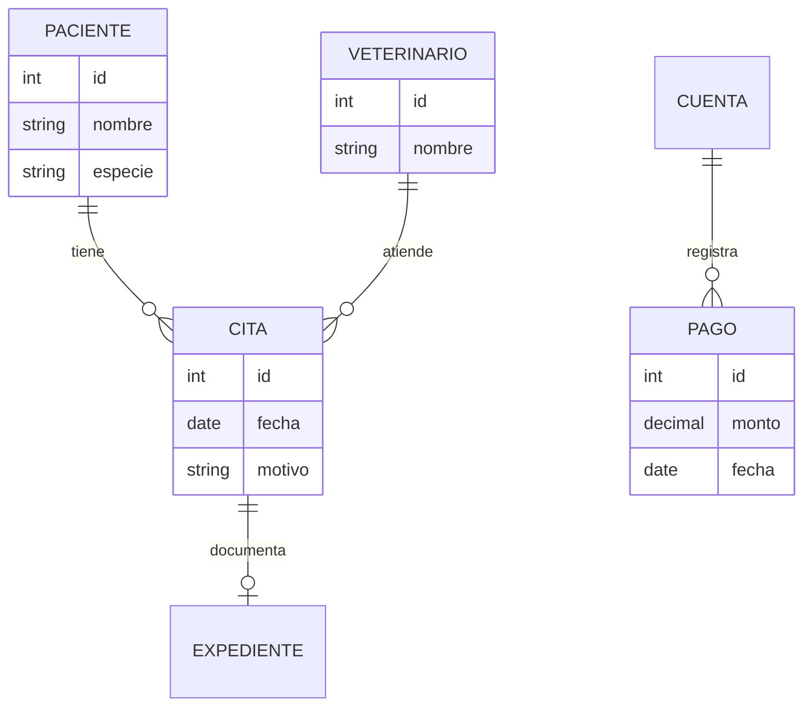

# Ejercicios de Mermaid: 5 diagramas de la guía

Actividad "Diagramas ADR - Ingeniería de Software" (SIS3407). Los cinco ejemplos salen de la Guía rápida de Mermaid y usan el caso de la clínica veterinaria que vimos en clase. De cada uno dejo el código original, mi versión modificada y qué pasó con el dibujo. En cada modificación hice lo mismo: agregué una caja, cambié una etiqueta y quité una flecha.

Los diagramas están escritos como texto de Mermaid para que se puedan comparar entre versiones. GitHub los dibuja directo en esta página, y también se pueden pegar en [mermaid.live](https://mermaid.live).

---

## Ejemplo 4 · Diagrama de flujo con decisiones

Las validaciones de un abono: primero se revisa que el monto sea mayor a cero y luego que no exceda el saldo.

**Original**

**Modificado**

**Qué cambié y qué pasó**

- **Caja nueva:** `bit`, "Registrar en bitácora", entre aplicar el abono y el fin.
- **Etiqueta cambiada:** "Monto invalido" pasó a "Monto inválido" y las ramas "Si" pasaron a "Sí".
- **Flecha quitada:** `err2 --> fin`. La caja "Excede el saldo" quedó sin salida: Mermaid la dibuja igual, pero el flujo ya no termina en ese camino.

---

## Ejemplo 5 · Diagrama de secuencia

Cómo se pasan los mensajes entre las piezas cuando la recepcionista registra un abono.

**Original**

**Modificado**

**Qué cambié y qué pasó**

- **Pieza nueva:** `Not`, el Notificador, con un mensaje `enviarRecibo(500)` que le manda Cobros.
- **Etiqueta cambiada:** la respuesta de Agenda pasó de "Consulta general" a "Cirugía".
- **Flecha quitada:** la respuesta `BD-->>Cob: Listo`. Ahora Cobros guarda el pago y avisa que quedó registrado sin esperar confirmación de la base de datos. El diagrama lo dibuja sin problema, pero el flujo ya no es confiable.

---

## Ejemplo 6 · Diagrama de clases

Atributos, métodos, visibilidad y multiplicidad de la cuenta de un paciente.

**Original**

**Modificado**

**Qué cambié y qué pasó**

- **Clase nueva:** `Recibo`, con folio, total y el método `imprimir()`, conectada a `Pago`.
- **Etiqueta cambiada:** "tiene" pasó a "posee".
- **Flecha quitada:** `CuentaDePaciente "1" --> "*" Pago : registra`. La cuenta sigue teniendo el atributo `pagos`, pero el dibujo ya no muestra la relación con `Pago`. Ese es el tipo de inconsistencia que se ve en el diagrama antes que en el código.

---

## Ejemplo 7 · Diagrama de estados

Por qué estados pasa una cita y qué evento la mueve de uno a otro.

**Original**

**Modificado**

**Qué cambié y qué pasó**

- **Estado nuevo:** `Reagendada`, que sale de `Confirmada` y regresa a `Confirmada` cuando el dueño confirma de nuevo.
- **Etiqueta cambiada:** "llega a consulta" pasó a "es atendida" (y "dueno" a "dueño").
- **Flecha quitada:** `Cancelada --> [*]`. El estado Cancelada ya no termina: parece una cita que sigue viva para siempre, aunque nadie pueda hacer nada con ella.

---

## Ejemplo 8 · Diagrama entidad-relación

Las tablas de la base de datos y cómo se relacionan.

**Original**

**Modificado**

**Qué cambié y qué pasó**

- **Entidad nueva:** `VETERINARIO`, que atiende muchas citas.
- **Etiqueta cambiada:** la relación entre cita y expediente pasó de "genera" a "documenta".
- **Flecha quitada:** `PACIENTE ||--|| CUENTA : tiene`. La cuenta quedó desconectada del paciente: solo se relaciona con sus pagos, así que no hay forma de saber de quién es.
